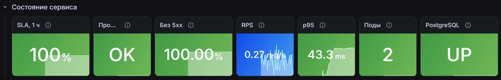
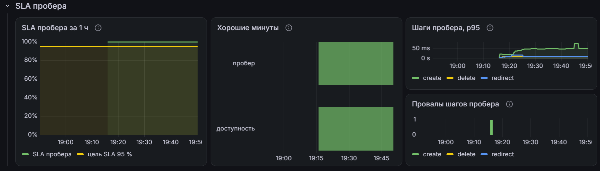
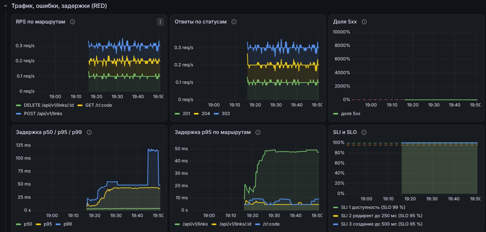
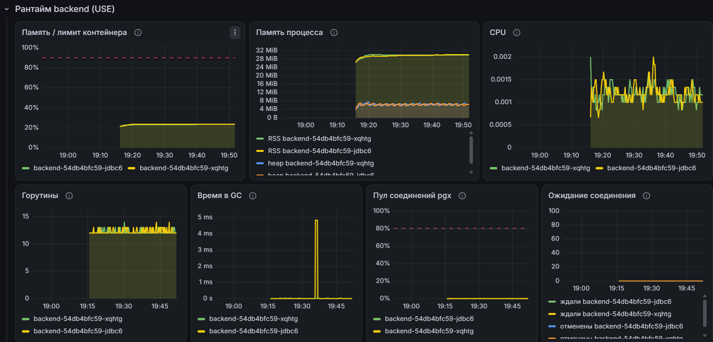
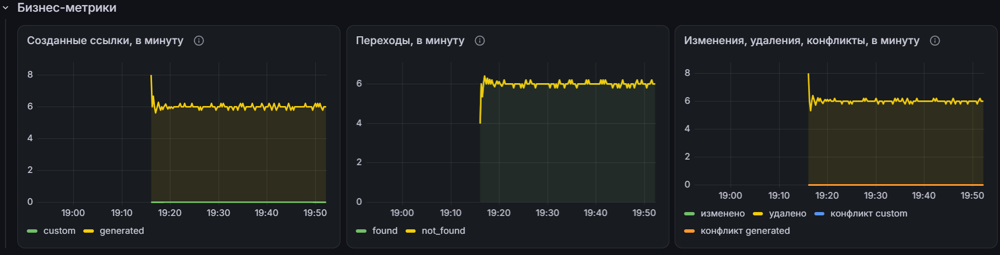
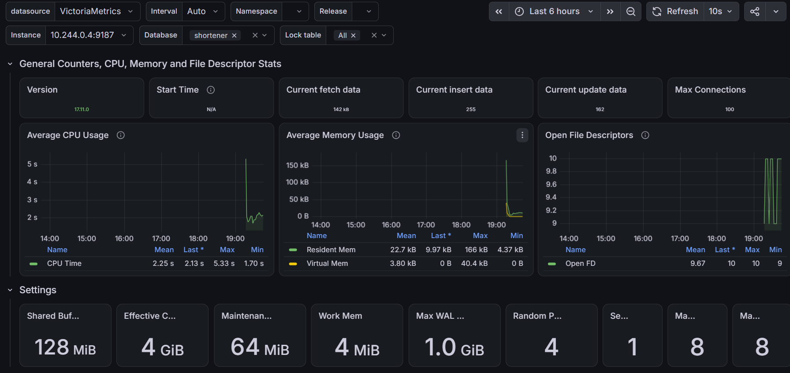

# Отчёт: дашборды Grafana для URL Shortener

В minikube установлена Grafana, подключена к VictoriaMetrics из прошлых заданий. Построен дашборд приложения
«URL Shortener» (`url-shortener.json`) и импортирован готовый дашборд PostgreSQL Exporter.

## 1. Дашборд приложения «URL Shortener»

Импорт: Dashboards → New → Import → загрузить `url-shortener.json`. Все панели ссылаются на источник по `uid`
`victoriametrics`, поэтому выбирать его при импорте не нужно.

Дашборд построен по принципу **drill-down**: сверху - «здоров ли сервис» за 5 секунд, ниже - всё более детальные
панели для поиска причины. Строки (rows) группируют панели по смыслу, у каждой панели есть описание,
единицы измерения и пороги цветом совпадают с SLO и алертами из прошлых заданий. Обновление каждые 30 секунд,
диапазон по умолчанию - последний час. В шапке - ссылка на дашборд PostgreSQL.

### 1.1. Состояние сервиса (Stat) - Golden Signals одной строкой

| Панель | Метрика | Почему |
|---|---|---|
| SLA, 1 ч | `urlshort_prober_runs_total` | главный итог: выполняется ли SLA пользовательского сценария. Красный ниже цели 95 % |
| Пробер | `urlshort_prober_last_run_success` | OK / FAIL последнего прогона - самый быстрый ответ «работает ли сервис прямо сейчас» |
| Без 5xx | `http_request_duration_seconds_count` (статусы) | **errors**: доля ответов без 5xx, красный ниже SLO 99 % |
| RPS | `http_request_duration_seconds_count` | **traffic**: есть ли вообще нагрузка |
| p95 | `http_request_duration_seconds_bucket` | **latency**: жёлтый выше 250 мс (порог SLO редиректа), красный выше 500 мс |
| Поды | `up{app="backend"}` | **saturation** / ёмкость: сколько реплик из 2 живы и отдают метрики |
| PostgreSQL | `pg_up` | UP / DOWN базы - самая частая внешняя причина ошибок |

### 1.2. SLA пробера - отдельный блок

| Панель | Запрос | Что показывает |
|---|---|---|
| SLA пробера за 1 ч | `avg_over_time((SLI пробера >= bool 0.99)[1h:1m])` и линия `0.95` | SLA (TBSLO) во времени: доля хороших минут за скользящий час и цель |
| Хорошие минуты | `SLI >= bool 0.99` для пробера и доступности | state timeline: в какие именно минуты SLO нарушался - видно длительность и момент сбоя |
| Шаги пробера, p95 | `histogram_quantile(0.95, … urlshort_prober_step_duration_seconds_bucket …)` по `step` | какой шаг сценария (создание, переход, удаление) замедлился |
| Провалы шагов пробера | `increase(urlshort_prober_step_failures_total[1m])` по `step` | на каком шаге ломается сценарий |

Формула SLA - из прошлого задания: SLI пробера за минуту = успешные прогоны / все прогоны, минута хорошая, если
SLI ≥ 99 %, SLA = доля хороших минут за период (в демонстрации - час, в реальности - месяц).

### 1.3. Трафик, ошибки, задержки (RED)

| Панель | Метрика | Подход |
|---|---|---|
| RPS по маршрутам | `rate(http_request_duration_seconds_count[1m])` по `method`, `route` | **Rate** - какие эндпоинты нагружены |
| Ответы по статусам | то же по `status` | **Errors** - структура ответов: 2xx/3xx/4xx/5xx |
| Доля 5xx | 5xx / все за минуту, пунктир - SLO 1 % | **Errors** - момент нарушения SLO |
| Задержка p50 / p95 / p99 | `histogram_quantile` по бакетам за 5 минут | **Duration** - типичный запрос и «хвост» |
| Задержка p95 по маршрутам | то же по `route` | **Duration** - какой эндпоинт тормозит |
| SLI и SLO | SLI 1-3 из прошлого задания, пунктиры 95 % и 99 % | связь метрик с SLO |

Маршруты - шаблоны (`/r/:code`, `/api/v1/links/:id`), а не реальные пути, поэтому рядов немного и графики читаемы.

### 1.4. Рантайм backend (USE)

Переменная **«Под backend»** (`label_values(process_resident_memory_bytes{app="backend"}, pod)`, можно выбрать
одну реплику или все) фильтрует панели строки - чтобы разобраться с конкретной репликой.

| Панель | Метрика | Подход |
|---|---|---|
| Память / лимит контейнера | `process_resident_memory_bytes` / `container_spec_memory_limit_bytes` (cAdvisor) | **Utilization**, пунктир - порог алерта `BackendMemoryHigh` 90 % |
| Память процесса | `process_resident_memory_bytes`, `go_memstats_heap_inuse_bytes` | рост кучи без возврата - утечка |
| CPU | `rate(process_cpu_seconds_total[1m])` | **Utilization**, пунктир - лимит 200m |
| Горутины | `go_goroutines` | постоянный рост - зависшие запросы, утечка |
| Время в GC | `rate(go_gc_duration_seconds_sum[1m])` | CPU, потраченный на сборку мусора |
| Пул соединений pgx | `pgxpool_acquired_conns / pgxpool_max_conns` | **Utilization** пула соединений с базой, пунктир 80 % |
| Ожидание соединения | `rate(pgxpool_empty_acquire[1m])`, `rate(pgxpool_canceled_acquire_count[1m])` | **Saturation** (запрос ждал свободное соединение) и **Errors** (ожидание отменено) |

### 1.5. Бизнес-метрики

| Панель | Метрика | Зачем |
|---|---|---|
| Созданные ссылки, в минуту | `urlshort_links_created_total` по `code_source` | основная бизнес-операция |
| Переходы, в минуту | `urlshort_redirects_total` по `result` | использование ссылок; рост `not_found` - битые ссылки или перебор кодов |
| Изменения, удаления, конфликты | `urlshort_links_updated_total`, `urlshort_links_deleted_total`, `urlshort_code_conflicts_total` | рост конфликтов `generated` - заканчивается пространство кодов |

## 2. Дашборд PostgreSQL Exporter

Импортирован готовый дашборд **PostgreSQL Database** с grafana.com (ID **9628**), рассчитанный на метрики
`postgres-exporter`: Dashboards → New → Import → ID `9628` → Load → источник `VictoriaMetrics` → Import.

Метрики приходят от сайдкара `postgres-exporter` в поде `postgres-0` (ДЗ4). На дашборде: доступность и версия
PostgreSQL, число подключений, транзакции (commit / rollback), операции со строками (fetch / insert / update /
delete), попадания в кэш, конфликты и deadlock'и, размер базы, настройки сервера. Переменные дашборда - инстанс и
база данных (`shortener`).

## 3. Источники данных

| Источник | Что даёт | Чем собирается |
|---|---|---|
| backend (`/metrics` на 9090) | HTTP-метрики, рантайм Go, пул pgx, бизнес-метрики | `client_golang`, service discovery по аннотациям |
| prober (`/metrics` на 9090) | результаты и длительность шагов синтетического сценария | то же |
| postgres-exporter (9187) | метрики PostgreSQL | то же |
| cAdvisor (kubelet) | лимиты и потребление контейнеров | `kubernetes-nodes-cadvisor` |

Всё хранится в VictoriaMetrics single, Grafana обращается к ней через один источник данных `VictoriaMetrics`: тип
`prometheus` (VictoriaMetrics совместима с Prometheus API).
