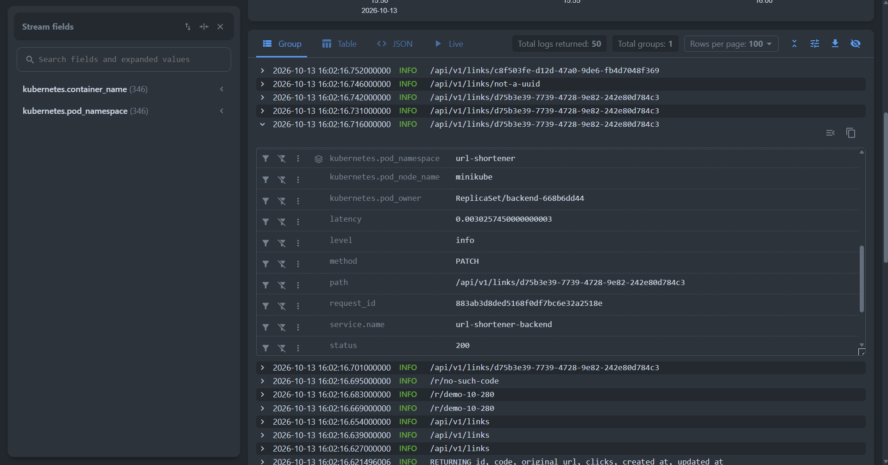
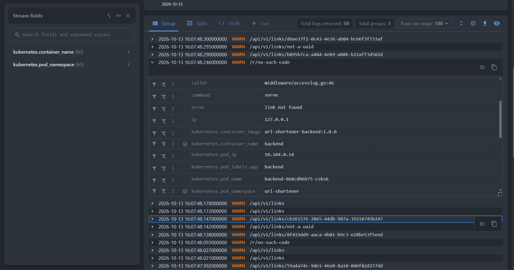
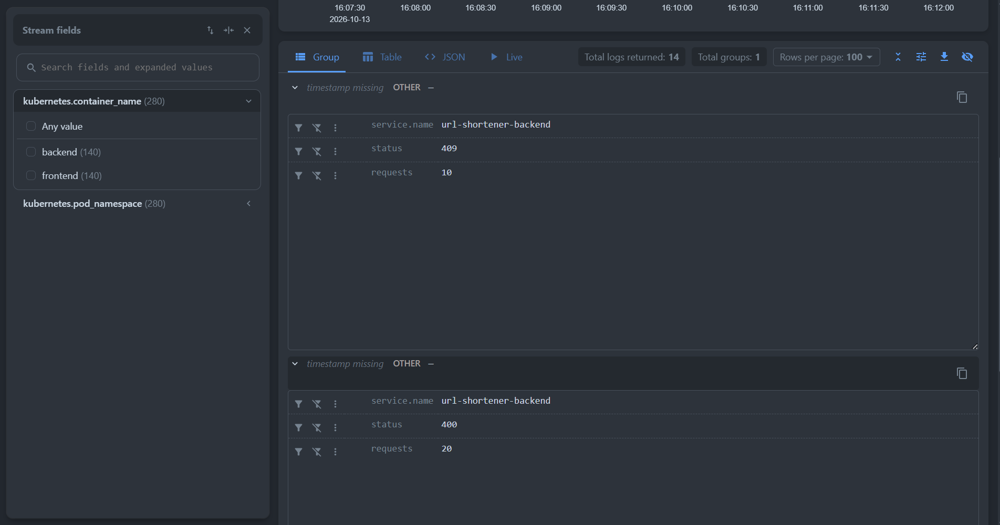
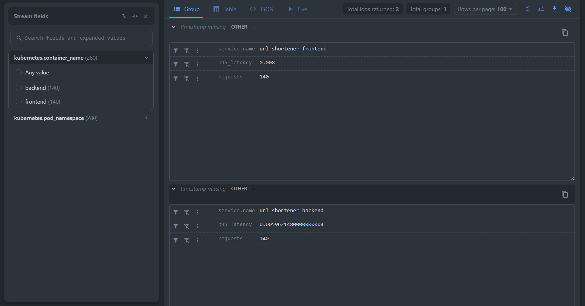

# Отчёт: сбор логов приложения в VictoriaLogs

В кластер minikube, где уже работает приложение из прошлого задания (URL Shortener: frontend на nginx, backend на Go,
PostgreSQL), развёрнута VictoriaLogs и настроена доставка логов приложения в неё через Vector.

**Окружение:** minikube v1.39.0 (драйвер `docker`, runtime `docker`), Kubernetes v1.37.0,
VictoriaLogs v1.53.0 (single-node), Vector 0.59.0.

## 1. Доставка логов

### 1.1. Почему Vector в виде DaemonSet

Выбран стандартный для Kubernetes способ: агент на каждом узле читает файлы логов контейнеров из `/var/log/pods`.

- Приложение не меняется и не зависит от хранилища (фактор XI): оно только пишет в stdout. Если VictoriaLogs
  недоступна, приложение этого не замечает - Vector буферизует записи и повторяет отправку.
- Один агент на узел, а не на под, как было бы с сайдкаром: меньше потребление ресурсов, а новые поды и сервисы
  подхватываются автоматически без изменения их манифестов.
- Метаданные Kubernetes добавляет агент (namespace, под, узел, метки): на семинаре отмечалось, что в больших
  компаниях окружение докидывает коллектор, а не приложение.
- Прямая отправка из приложения (OTLP, Elasticsearch bulk) потребовала бы менять код и учить приложение буферизации
  и повторам; сайдкар нужен, когда приложение пишет логи в файл, а не в stdout. Ни то, ни другое здесь не нужно.

### 1.2. Объекты Kubernetes

| Файл | Объекты | Назначение |
|---|---|---|
| `00-namespace.yml` | Namespace `logging` | инфраструктура логов отдельно от приложения в namespace `url-shortener`; удаляется одной командой `kubectl delete namespace logging` |
| `01-victorialogs.yml` | headless Service `victorialogs` (порт 9428), StatefulSet `victorialogs`, PVC `storage-victorialogs-0` (2Gi) | single-node VictoriaLogs. StatefulSet с `volumeClaimTemplates`, как у PostgreSQL: база с состоянием, собственный диск переживает пересоздание пода. Данные в `/storage`, логи хранятся 7 дней (`-retentionPeriod=7d`), пробы на `/health`. Внутри кластера доступна по имени `victorialogs.logging:9428` (туда отправляет логи Vector), снаружи - через `kubectl port-forward -n logging svc/victorialogs 9428:9428`, vmui по адресу `/select/vmui/` |
| `02-vector-rbac.yml` | ServiceAccount `vector`, ClusterRole `vector`, ClusterRoleBinding `vector` | Vector запрашивает у Kubernetes API метаданные подов. Права только на чтение (`get`, `list`, `watch`) для `pods`, `namespaces`, `nodes`. Нужен ClusterRole: Vector работает в namespace `logging`, а читает поды другого namespace, и `nodes`/`namespaces` - объекты уровня кластера |
| `03-vector-config.yml` | ConfigMap `vector-config` | конфигурация конвейера `vector.yaml` |
| `04-vector-daemonset.yml` | DaemonSet `vector` | агент на каждом узле |

Настройки DaemonSet:
- `serviceAccountName: vector` - права из RBAC;
- переменная `VECTOR_SELF_NODE_NAME` из `spec.nodeName` - Vector читает логи только подов своего узла;
- каталоги узла через `hostPath`, только на чтение: `/var/log/` (файлы `/var/log/pods/...`) и
  `/var/lib/docker/containers` (при runtime docker файлы в `/var/log/pods` - ссылки на этот каталог);
- `/var/lib/vector` (hostPath) - здесь Vector хранит позиции чтения файлов, после перезапуска пода он продолжает с того
  же места без потерь и дублей;
- пробы на `/health` встроенного API Vector (порт 8686).

## 2. Запросы LogsQL

### (а) Сырые записи за последние 15 минут

```
_time:15m
```



Все записи всех компонентов приложения за последние 15 минут, новые сверху. Видно, что JSON-логи разобраны на поля
(`service.name`, `level`, `status`, `path`, `request_id`...), у каждой записи есть служебные поля VictoriaLogs:
`_time` (время события), `_msg` (сообщение) и `_stream` (контейнер и namespace), а также метаданные пода от Vector

### (б) Фильтр по полю: ответы с ошибкой

```
_time:15m status:>=400
```



Только записи с HTTP-статусом 400 и выше - запросы, которые завершились ошибкой, из обоих сервисов: nginx и backend
пишут поле `status` с одинаковым именем, поэтому один фильтр работает для всех. `status:>=400` - фильтр по диапазону
значений поля. Аналогично работают фильтры по любому полю, например `level:warn` (ошибки клиента в backend),
`level:error` (внутренние ошибки backend и ошибки PostgreSQL)

### (в) `stats` с группировкой: запросы по сервисам и статусам

```
_time:15m status:* | stats by (service.name, status) count() as requests
```



Количество HTTP-запросов за 15 минут для каждой пары «сервис - статус». `status:*` оставляет только записи, где поле
`status` есть (access-логи), `| stats by (...) count()` группирует их и считает количество в каждой группе.
Видно распределение ответов по сервисам и долю ошибок

### (г) Агрегация: 95-й перцентиль задержки

```
_time:15m status:* | stats by (service.name) quantile(0.95, latency) as p95_latency, count() as requests
```

